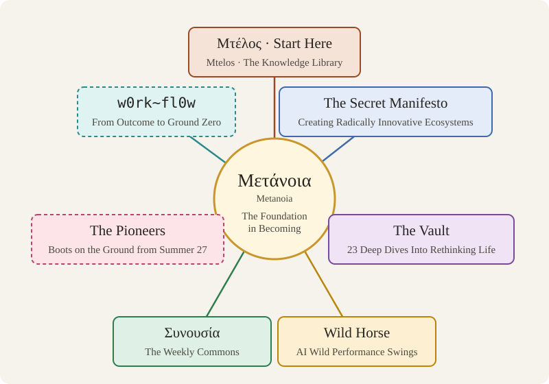

# Metanoia

A map of connected undertakings, all asking one question: how far, how well rounded, how fully developed a way of life can we imagine, and what would it take to get there?

## The Doors

- **[Mtelos](https://metanoia-hub.github.io/mtelos/)** — start here. A shared, constantly updated library of what works on the ground, gathered by institutions and by people themselves, reachable by anyone, in their own language.
- **[Manifesto](https://ma-om.windsofchange.world/)** — why we do this: the people who know, the places, and the knowledge they stand on.
- **[The Vault](https://thevault.windsofchange.world/)** — the collection behind the work. Bring a source, an idea, or a question we have missed.
- **[Wild Horse](https://github.com/metanoia-hub/wild-horse)** — open. An open investigation into why AI models do brilliant work, then suddenly don't.
- **Weekly Conversations** — opening soon. Scientists, CEOs and builders, meeting online every week.
- **The First Group** — opening soon. The first step towards a group of people actively researching a different way of life, from next summer.
- **w0rk~fl0w** — opening soon. Start from the outcome, not the to-do list.

The whole map: **https://metanoia-hub.github.io**
