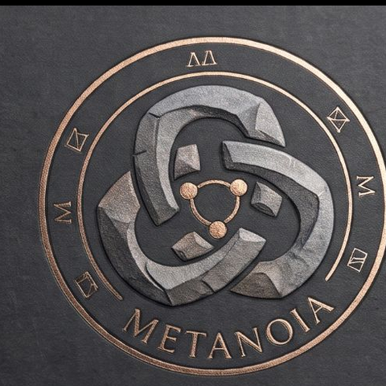
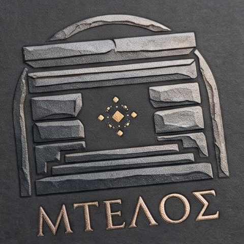
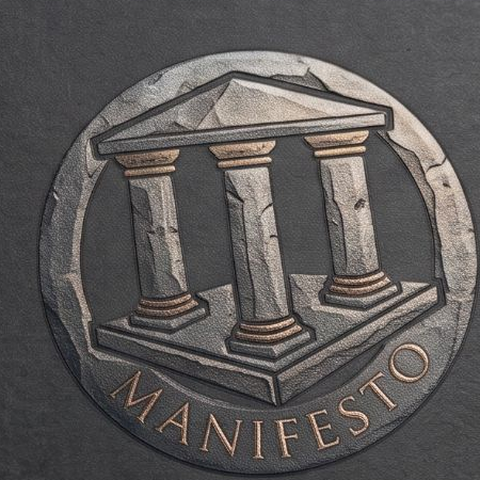
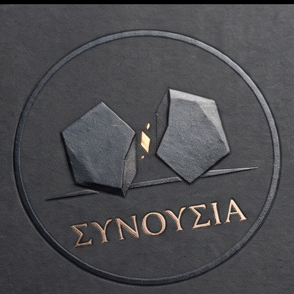

# Metanoia

A map of connected undertakings, all asking one question: how far, how well rounded, how fully developed a way of life can we imagine, and what would it take to get there?

## The Doors

-  **[Mtelos](https://metanoia-hub.github.io/mtelos/)** — start here. A shared, constantly updated library of what works on the ground, gathered by institutions and by people themselves, reachable by anyone, in their own language.
-  **[The Secret Manifesto](https://ma-om.windsofchange.world/)** — creating radically innovative ecosystems: the people who know, the places, and the knowledge they stand on.
- **[The Vault](https://thevault.windsofchange.world/)** — 23 deep dives into rethinking life. Bring a source, an idea, or a question we have missed.
- **[Wild Horse](https://github.com/metanoia-hub/wild-horse)** — open. AI's wild performance swings: open questions on why AI models do brilliant work, then suddenly don't.
-  **[Συνουσία](https://metanoia-hub.github.io/weekly-conversations/)** — open. The Metanoia Weekly Commons. Scientists, CEOs and builders, meeting online every week.
- **[The Pioneers](https://metanoia-hub.github.io/pioneers/)** — open. Boots on the ground from summer 27: people actively researching a different way of life, living it together.
- **w0rk~fl0w** — opening soon. From outcome to ground zero. Start from the outcome, not the to-do list.

The whole map: **https://metanoia-hub.github.io**
